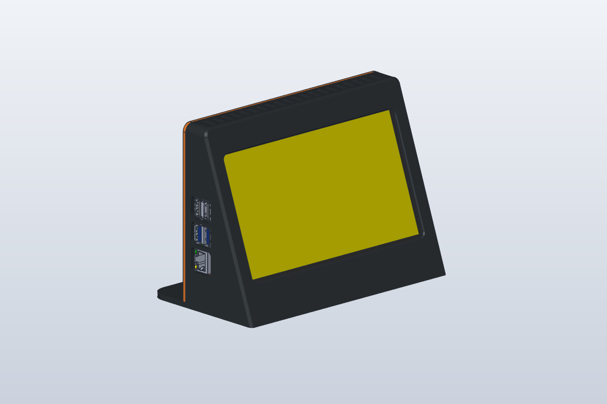
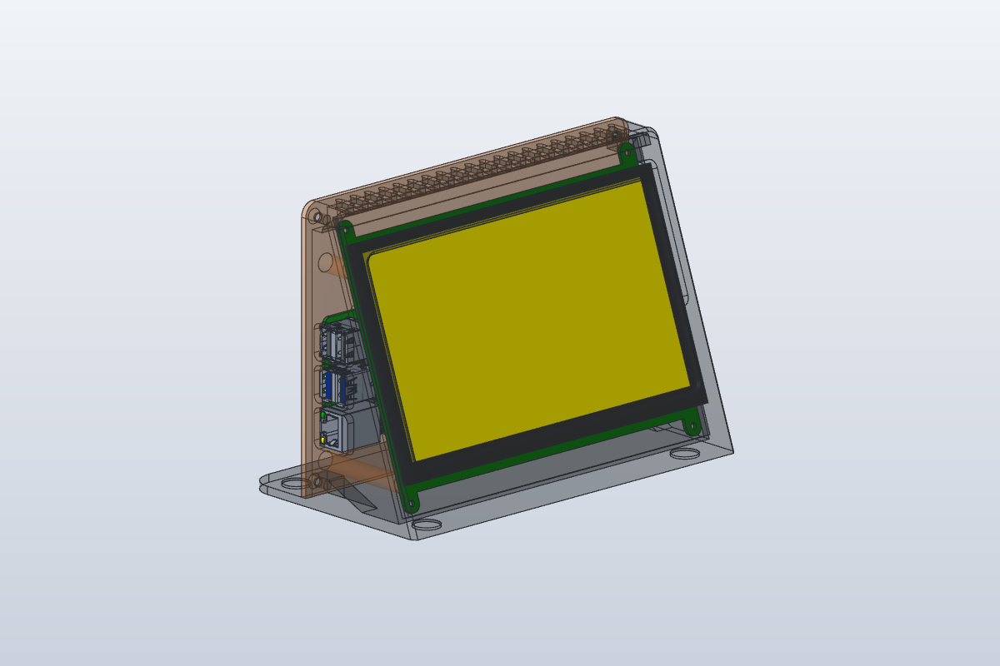

# lcd-deck

Supporto da scrivania stampabile in 3D per un display touch HDMI da 7″ 1024×600 (Kuman SC7BC / Elecrow 7″ C) con un Raspberry Pi 4 montato all'interno. Pensato come "deck" sempre acceso accanto al monitor, per un pannello di stato come [agents-deck](https://github.com/ggbeauty989/agents-deck).

Modellato con [SolidCraft](https://github.com/tangency-labs/solidcraft) tramite il suo server MCP.

## Cosa stampare (v4)

| File | Ingombro | Orientamento | Supporti |
|---|---|---|---|
| `deck-v4-scocca.stl` | 180 × 144 × 94 mm | frontale appoggiato sul piano (già orientato) | solo dentro l'apertura dei connettori sul fianco destro |
| `deck-v4-coperchio.stl` | 180 × 126 × 50 mm | faccia esterna sul piano (già orientato) | nessuno |

Consigliati PETG o PLA, strati da 0,2 mm, 3 perimetri, riempimento 15–20 %. Serve un piano da almeno 220 × 220 mm.

## Materiale

- 4 inserti a caldo in ottone **M3 × 4 mm** (diametro esterno 5 mm) nelle torrette del corpo
- 4 inserti a caldo in ottone **M2,5 × 4 mm** (diametro esterno 3,5 mm) nelle colonnine del coperchio
- 4 viti **M3 × 6** a testa svasata per chiudere il coperchio
- 4 viti **M2,5 × 5** per il Raspberry Pi
- 4 gommini o pezzetti di spugna adesiva da 3–5 mm per le punte dei pilastrini
- 4 piedini in gomma adesivi da 12 mm (opzionali, negli incavi sotto la base)
- cavo corto micro-HDMI → HDMI, cavo corto micro-USB per il touch, alimentatore USB-C per il Pi

I diametri dei fori per gli inserti sono parametri del progetto (`foro_inserto_m3` = 4,2 mm, `foro_inserto_m25` = 3,2 mm): se gli inserti entrano troppo duri o troppo lenti si correggono lì.

## Montaggio

1. Scalda e inserisci gli inserti M3 nelle torrette del corpo e gli M2,5 nelle colonnine del coperchio.
2. Inserisci lo schermo nella cornice da dietro: il vetro va nella sua tasca, con i connettori (HDMI, micro-USB, interruttore) sul lato destro guardando il deck da davanti.
3. Avvita il Raspberry Pi sulle colonnine del coperchio, componenti verso lo schermo, con le porte USB/Ethernet verso il fianco sinistro.
4. Collega i cavi: passano tutti dall'apertura laterale destra.
5. Metti i gommini sulle punte dei pilastrini e chiudi il coperchio con le 4 viti M3.

## Struttura del repository

- `deck-kuman7-pi4-v4.solidcraft`: progetto SolidCraft della versione attuale (parametrico)
- `deck-v4-assieme.step`: assieme corpo + coperchio in STEP
- `deck-v4-scocca.stl`, `deck-v4-coperchio.stl`: file da stampare, già riparati e verificati a tenuta
- `screenshot-*/`, `anteprima-*.png`: immagini delle varie versioni
- versioni precedenti (v1–v3) per riferimento; la v4 è quella da stampare
- `script/`: script con cui il deck è stato costruito e verificato
  - `mcpc.py`: client minimo per il server MCP di SolidCraft
  - `v4gen.py` + `v4run.sh` + `pipeline_v4.sh`: ricostruzione, esportazione e controlli della v4
  - `meshfix.py`: ripara i piccoli difetti di tassellazione degli STL esportati e si rifiuta di scrivere un file non a tenuta
  - `overhang.py`, `meshclash.py`, `conndist.py`, `standoffdist.py`, `pidist.py`: controlli di sbalzi, interferenze e spazi
  - gli script contengono ancora i percorsi della macchina su cui sono stati usati

## Modelli di terzi (non inclusi)

Le verifiche di ingombro sono state fatte con due modelli STEP di terzi, che non sono inclusi per motivi di licenza. Si trovano nella libreria GrabCAD:

- Raspberry Pi 4 Model B (`raspberry-pi-4-model-b-1`)
- Elecrow 7inch LCD Display (C) (`elecrow-7inch-lcd-display-c-1`)

Messi in `componenti/` come `raspberry-pi-4.step` ed `elecrow-7lcd-c.step`, permettono di rigenerare l'assieme con i componenti.

## Versioni

- **v1**: prima forma a cuneo inclinato di 20°
- **v2**: pareti più spesse, bordi arrotondati, finestra raccordata
- **v3**: correzioni per la stampa (smussi a 45° sul bordo a contatto col piano, finestre USB separate, rinforzi sotto le torrette)
- **v4**: vano adattato al circuito con linguette dell'Elecrow/Kuman (123 mm), apertura connettori corretta, fori per inserti in ottone, mesh esportata a tenuta
