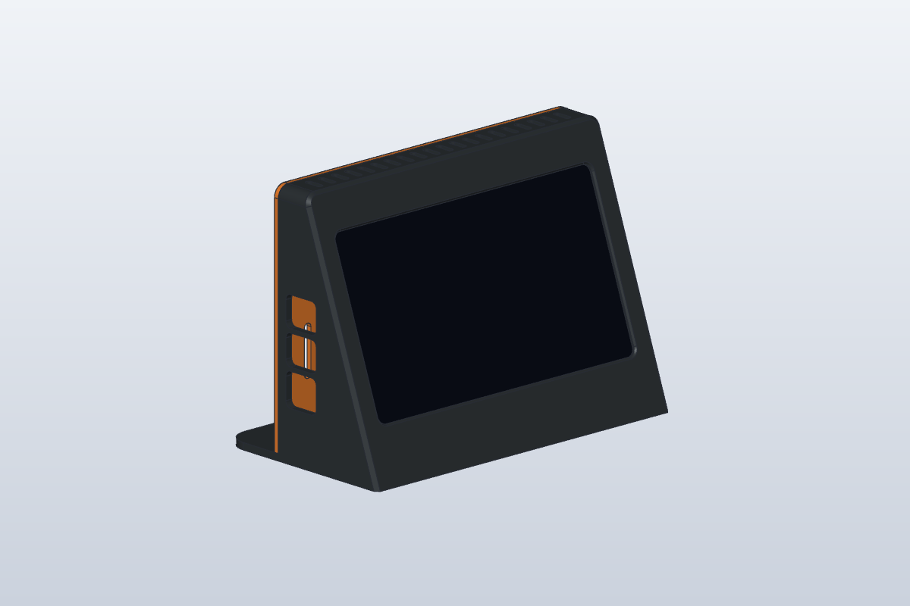
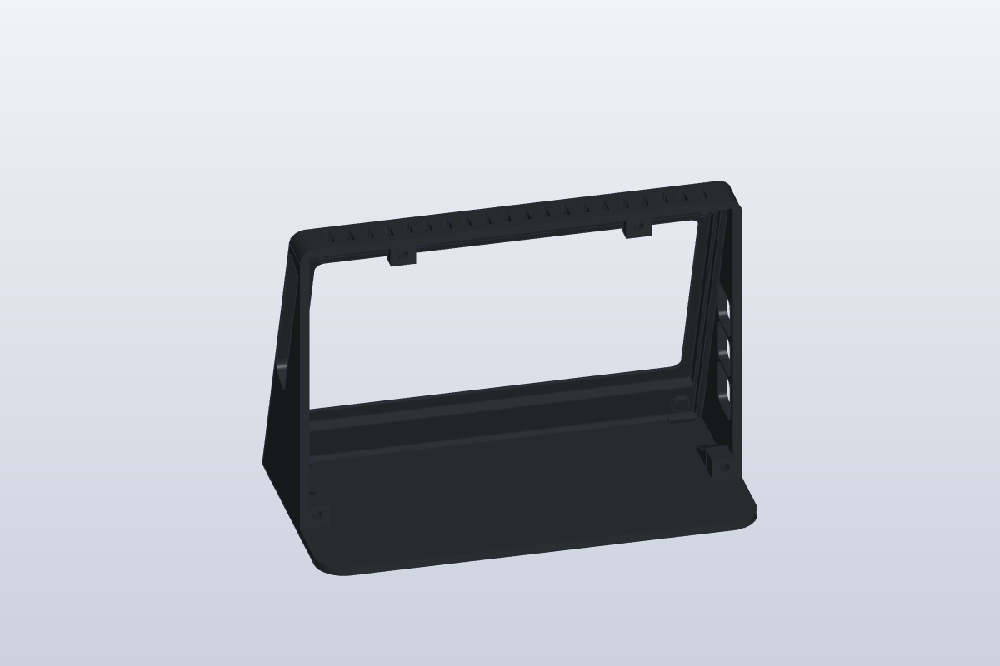
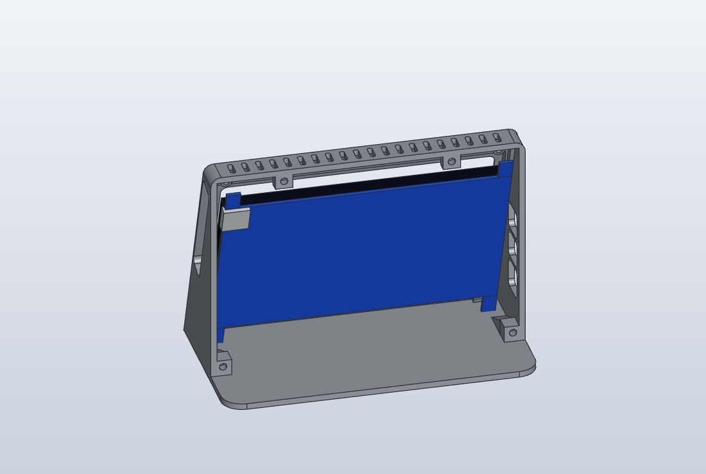
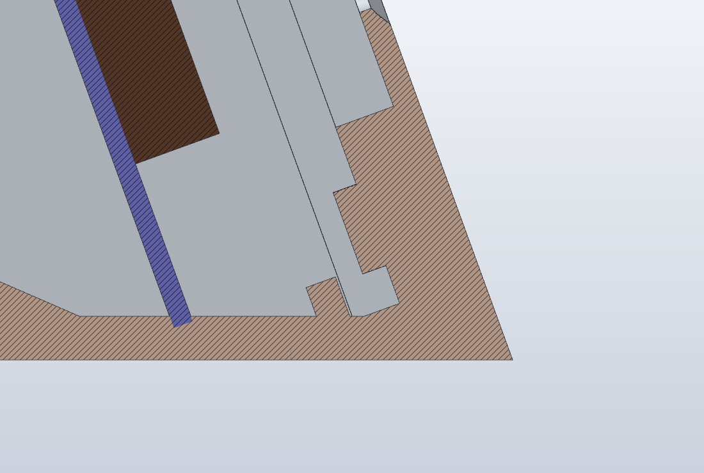
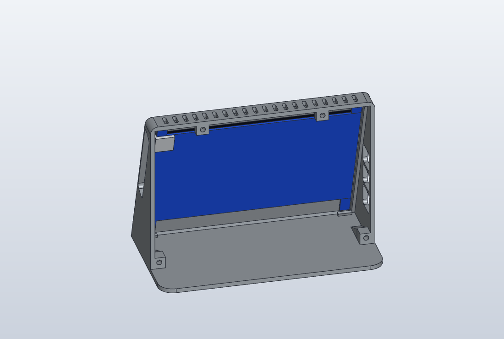
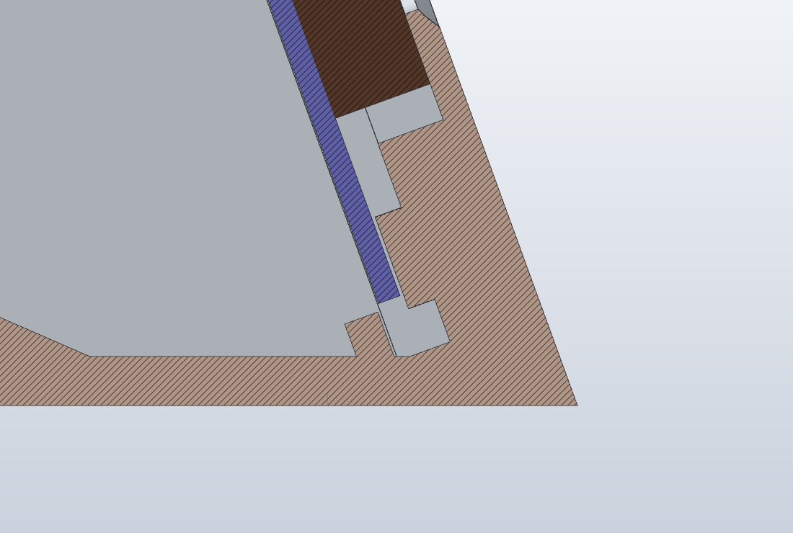
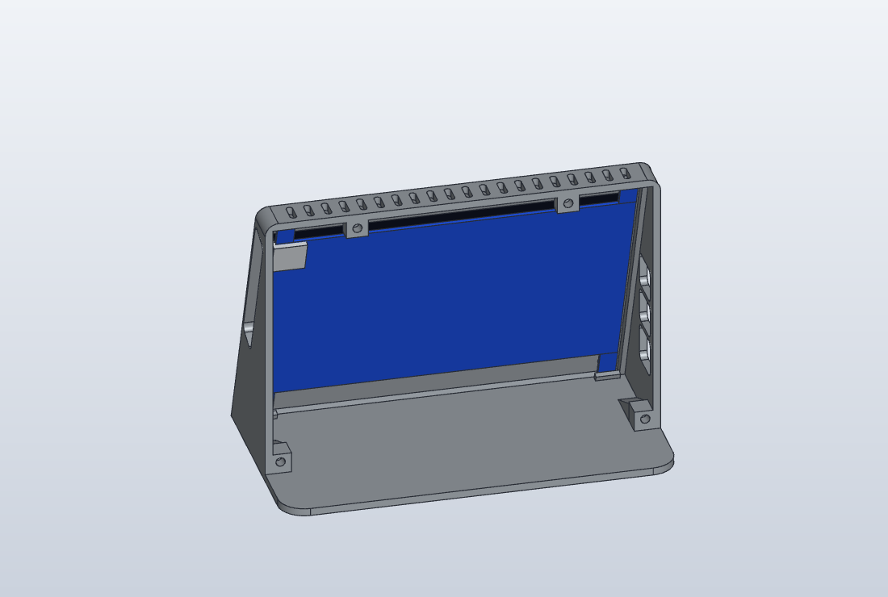
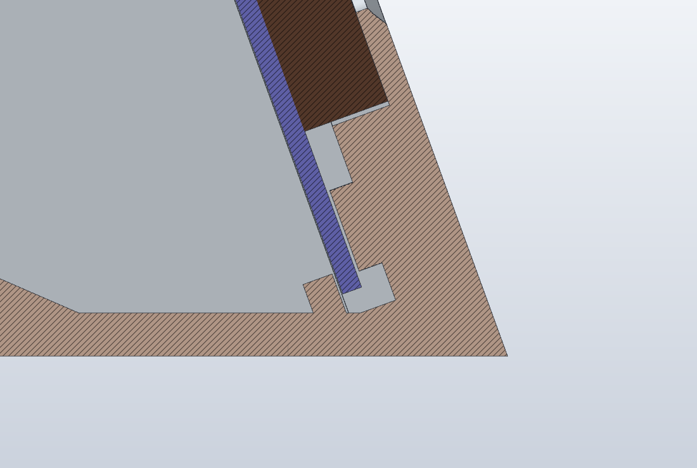
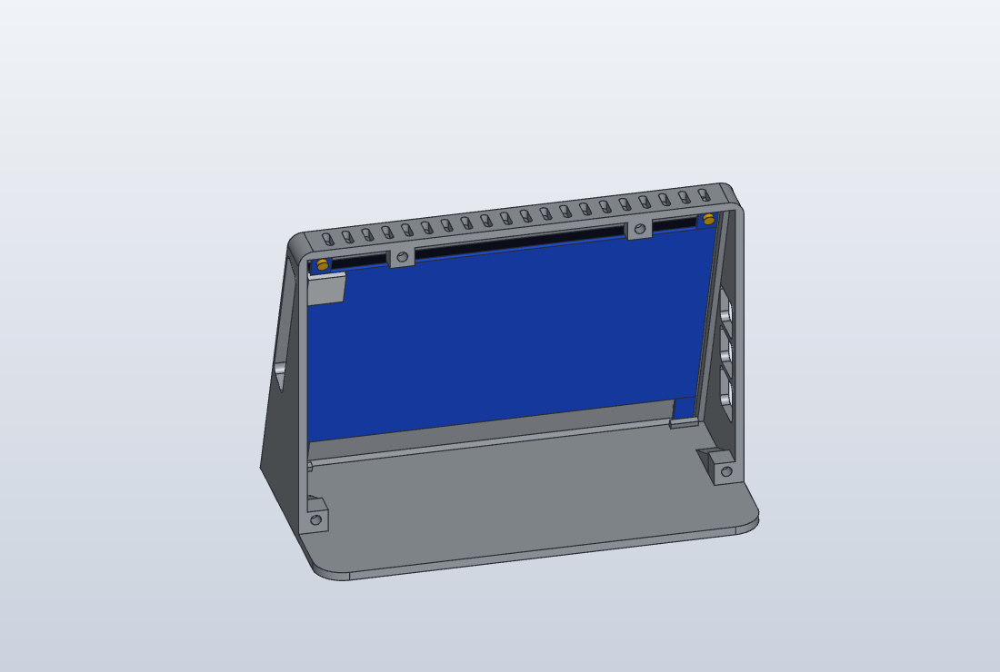
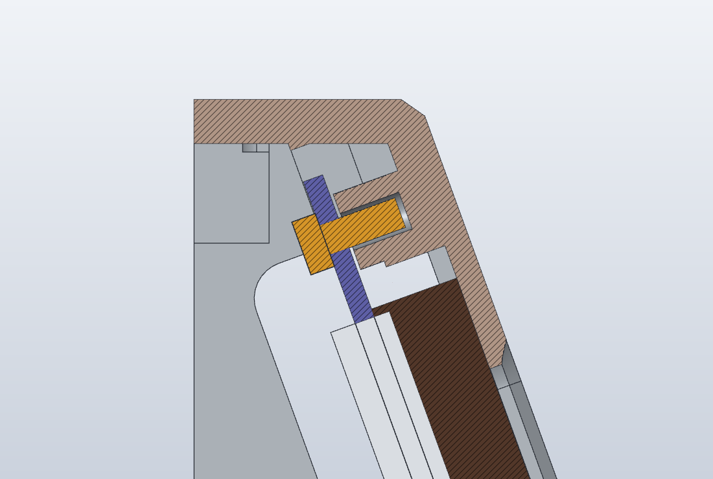

# lcd-deck

**[Italiano](#italiano) · [English](#english)**

---

## Italiano

Supporto da scrivania stampabile in 3D per un display touch HDMI da 7″ 1024×600 (Kuman SC7BC, scheda "7inch HDMI Display Rev2.5") con un Raspberry Pi 4 montato all'interno. Pensato come "deck" sempre acceso accanto al monitor, per un pannello di stato come [agents-deck](https://github.com/ggbeauty989/agents-deck).

Modellato con [SolidCraft](https://github.com/tangency-labs/solidcraft) tramite il suo server MCP. La versione attuale è la v9, dimensionata sulle misure del display vero.

### Cosa stampare (v9)

| File | Ingombro | Orientamento | Supporti |
|---|---|---|---|
| `deck-v9-scocca.stl` | 180 × 144 × 94 mm | frontale appoggiato sul piano (già orientato) | solo dentro l'apertura dei connettori sul fianco destro |
| `deck-v9-coperchio.stl` | 180 × 126 × 7,5 mm | faccia esterna sul piano (già orientato) | nessuno |

Il corpo della v9 è identico a quello della v8: se l'hai già stampato, basta stampare il nuovo coperchio.

Consigliati PETG o PLA, strati da 0,2 mm, 3 perimetri, riempimento 15–20 %. Serve un piano da almeno 220 × 220 mm.

### Materiale

- 10 inserti a caldo in ottone **M3 × 4 mm** (diametro esterno 5 mm): 4 nelle torrette del corpo per il coperchio, 2 nelle basi in alto per lo schermo, 4 nelle colonnine del coperchio per il Raspberry Pi
- 4 viti **M3 × 6** a testa svasata per chiudere il coperchio
- 4 viti **M3 × 6** per il Raspberry Pi. I fori del Pi sono da 2,7 mm: vanno allargati a 3,2 mm con una punta
- 2 viti **M3 × 5** o **M3 × 6** per le linguette in alto dello schermo. I fori delle linguette sono da 2,9–3 mm: se la vite non passa, ripassali con una punta da 3,2 mm
- 4 piedini in gomma adesivi da 12 mm (opzionali, negli incavi sotto la base)
- cavo corto micro-HDMI → HDMI, cavo corto micro-USB per il touch, alimentatore USB-C per il Pi

Il diametro dei fori per gli inserti è un parametro del progetto (`foro_inserto_m3` = 4,2 mm): se gli inserti entrano troppo duri o troppo lenti si corregge lì.

### Montaggio

1. Scalda e inserisci gli inserti M3: nelle 4 torrette del corpo, nelle 2 basi in alto dentro la cornice e nelle 4 colonnine del coperchio.
2. Inserisci lo schermo da dietro, vetro verso il frontale e connettori sul lato destro (guardando il deck da davanti). Infilalo spostato di 2–3 mm verso l'alto (il lato con le feritoie) e appoggialo sul bordino frontale.
3. Fallo scivolare verso il basso: le due linguette in basso entrano sotto i due dentini.
4. Avvita le due linguette in alto nelle loro basi con le viti M3: tengono lo schermo premuto contro il bordino e gli impediscono di risalire.
5. Allarga a 3,2 mm i 4 fori del Raspberry Pi e avvitalo sulle colonnine del coperchio con le viti M3 × 6, componenti verso lo schermo, con le porte USB/Ethernet verso il fianco sinistro.
6. Collega i cavi: passano tutti dall'apertura laterale destra. Chiudi il coperchio con le 4 viti M3.

#### Montaggio dello schermo, passo per passo

A sinistra il deck visto da dietro senza coperchio; a destra una sezione verticale che passa per le linguette di sinistra (marrone: corpo stampato, scuro: vetro, blu: circuito e linguetta, giallo: vite).

| Fase | Dall'interno | In sezione |
|---|---|---|
| 1. Lo schermo arriva da dietro, spostato di 2–3 mm verso l'alto |  |  |
| 2. Il vetro appoggia sul bordino; la linguetta in basso è sopra il dentino |  |  |
| 3. Lo schermo scivola in basso: la linguetta entra sotto il dentino |  |  |
| 4. Le due viti in alto entrano negli inserti e bloccano lo schermo |  |  |

### Struttura del repository

- `deck-kuman7-pi4-v9.solidcraft`: progetto SolidCraft della versione attuale (parametrico)
- `deck-v9-assieme.step`: assieme corpo + coperchio in STEP
- `deck-v9-scocca.stl`, `deck-v9-coperchio.stl`: file da stampare, già riparati e verificati a tenuta
- `screenshot-v5/`: immagini della v5, valide anche per la v9 (cambiano la forma dei dentini, delle basi in alto e delle colonnine del Pi, mezzo millimetro di posizione dei fori e la finestra, più grande e spostata sull'immagine)
- `old/`: versioni precedenti, solo per riferimento
  - `old/v1/` … `old/v8/`: progetto, STEP, STL e immagini di ciascuna versione
  - `old/script/`: gli script che hanno costruito le versioni 2–8
- `script/`: script con cui la v9 è stata costruita e verificata
  - `mcpc.py`: client minimo per il server MCP di SolidCraft
  - `v9gen.py` + `v9run.sh` + `pipeline_v9.sh`: ricostruzione, esportazione e controlli della v9
  - `picheck_v9.sh`: mette il modello ufficiale del Pi 4 sul coperchio e misura lo spazio tra i componenti sotto il Pi e le colonnine (serve `componenti/raspberry-pi-4.step`)
  - `kcheck_gen.py`, `kcheck_report.py`: verifica del display (dalle misure reali) montato, durante l'avvicinamento e durante lo scorrimento sotto i dentini, con un margine per le tolleranze di stampa (0,4 mm nella pipeline)
  - `meshfix.py`: ripara i piccoli difetti di tassellazione degli STL esportati e si rifiuta di scrivere un file non a tenuta
  - `overhang.py`, `meshclash.py`, `conndist.py`, `standoffdist.py`, `pidist.py`: controlli di sbalzi, interferenze e spazi
  - gli script contengono ancora i percorsi della macchina su cui sono stati usati

### Modelli di terzi (non inclusi)

Le verifiche con il Raspberry Pi usano il modello STEP ufficiale, che non è incluso per motivi di licenza. Si trova nella libreria GrabCAD (`raspberry-pi-4-model-b-1`); messo in `componenti/raspberry-pi-4.step` permette di rigenerare l'assieme con il Pi. Il display è modellato direttamente dalle misure prese sul pezzo vero.

### Versioni

- **v1**: prima forma a cuneo inclinato di 20°
- **v2**: pareti più spesse, bordi arrotondati, finestra raccordata
- **v3**: correzioni per la stampa (smussi a 45° sul bordo a contatto col piano, finestre USB separate, rinforzi sotto le torrette)
- **v4**: tarata sul modello Elecrow 7″ (C), fori per inserti in ottone, mesh esportata a tenuta. Sul Kuman reale il display non entra.
- **v5**: dimensionata sulle misure del Kuman reale (linguette, fori, connettore HDMI). Lo schermo è fissato con due dentini in basso e due viti M2,5 in alto; apertura dei connettori allargata per le spine; torrette superiori del coperchio spostate fuori dal percorso delle linguette; niente più pilastrini nel coperchio. Stampata, lo schermo non scivola sotto i dentini: tra linguetta e dentino c'erano solo 0,2 mm, che lo sbalzo stampato annulla.
- **v6**: dentini spostati indietro di 0,4 mm (0,6 mm di gioco dietro la linguetta) e con uno smusso d'invito da 0,8 mm sullo spigolo d'ingresso; verificata con 0,4 mm di margine di stampa. Fori delle linguette a 157 mm di interasse in orizzontale (misurato), con basi, inserti e dentini spostati di conseguenza. Finestra alzata di 2 mm, perché l'immagine non è centrata nel vetro (bordo nero di 4,75 mm sopra e 8,7 mm sotto). Coperchio uguale alla v5. Stampata, i dentini funzionano ma l'immagine viene tagliata sul lato opposto all'HDMI: in orizzontale non è centrata nel vetro, e la finestra lasciava solo 1,4 mm di margine.
- **v7**: finestra centrata sull'immagine misurata (bordo nero del vetro: 4,75 mm sopra, 8,5 sotto, 6,3 sul lato HDMI, 3,45 sul lato opposto) e più grande, con 2,5 mm di margine attorno all'immagine (2,25 sul lato opposto all'HDMI, per tenere almeno 1,2 mm di vetro sotto la cornice). Il resto è uguale alla v6.
- **v8**: le basi in alto dello schermo prendono inserti M3 invece di M2,5 (foro Ø4,2, profondo 5 mm). Sono rettangolari, 9 × 8 mm, e cominciano subito sopra il vetro sollevato durante l'inserimento: sotto l'inserto restano 1,4 mm di parete, sugli altri lati 2,4. Le colonnine del Raspberry Pi restano M2,5. Il resto è uguale alla v7.
- **v9**: anche le colonnine del Raspberry Pi nel coperchio prendono inserti M3 (foro Ø4,2, profondo 5 mm), quindi i fori del Pi vanno allargati a 3,2 mm. Le colonnine sono a gradino: Ø7,6 alla base e Ø6,6 negli ultimi 2 mm sotto la scheda, dove sporgono le saldature del connettore GPIO (0,6 mm di spazio dal modello del Pi). Corpo uguale alla v8.

---

## English

A 3D-printable desk stand for a 7″ 1024×600 HDMI touch display (Kuman SC7BC, board "7inch HDMI Display Rev2.5") with a Raspberry Pi 4 mounted inside. Meant as an always-on "deck" next to your monitor, for a status board such as [agents-deck](https://github.com/ggbeauty989/agents-deck).

Modelled in [SolidCraft](https://github.com/tangency-labs/solidcraft) through its MCP server. The current version is v9, sized on measurements of the real display.

### What to print (v9)

| File | Size | Orientation | Supports |
|---|---|---|---|
| `deck-v9-scocca.stl` (body) | 180 × 144 × 94 mm | front face on the bed (already oriented) | only inside the connector opening on the right side |
| `deck-v9-coperchio.stl` (back cover) | 180 × 126 × 7.5 mm | outer face on the bed (already oriented) | none |

The v9 body is identical to the v8 one: if you already printed it, only the new cover needs printing.

PETG or PLA recommended, 0.2 mm layers, 3 perimeters, 15–20 % infill. Needs a bed of at least 220 × 220 mm.

### Parts

- 10 brass heat-set inserts **M3 × 4 mm** (5 mm outer diameter): 4 in the body's bosses for the cover, 2 in the top screen pads, 4 in the cover's Raspberry Pi standoffs
- 4 **M3 × 6** countersunk screws to close the cover
- 4 **M3 × 6** screws for the Raspberry Pi. The Pi's holes are 2.7 mm: open them up to 3.2 mm with a drill bit
- 2 **M3 × 5** or **M3 × 6** screws for the screen's top tabs. The tab holes are 2.9–3 mm: if the screw does not go through, open them up with a 3.2 mm drill bit
- 4 adhesive 12 mm rubber feet (optional, in the recesses under the base)
- short micro-HDMI → HDMI cable, short micro-USB cable for touch, USB-C power supply for the Pi

The insert hole diameter is a design parameter (`foro_inserto_m3` = 4.2 mm): if your inserts go in too tight or too loose, adjust it there.

### Assembly

1. Heat-set the M3 inserts: into the body's 4 bosses, the 2 top pads inside the frame and the cover's 4 standoffs.
2. Fit the screen from behind, glass towards the front and connectors on the right side (as seen from the front). Put it in 2–3 mm higher than its final place (towards the side with the vents) and lay it on the front lip.
3. Slide it down: the two bottom tabs go under the two clips.
4. Screw the two top tabs to their pads with the M3 screws: they hold the screen against the lip and stop it from sliding back up.
5. Open the Raspberry Pi's 4 holes up to 3.2 mm and screw it onto the cover's standoffs with the M3 × 6 screws, components facing the screen, USB/Ethernet ports towards the left side.
6. Plug in the cables: they all pass through the right-hand side opening. Close the cover with the 4 M3 screws.

#### Fitting the screen, step by step

Left: the deck seen from behind without its cover; right: a vertical section through the left-hand tabs (brown: printed body, dark: glass, blue: board and tab, yellow: screw).

| Step | From inside | In section |
|---|---|---|
| 1. The screen comes in from behind, 2–3 mm higher than its final place |  |  |
| 2. The glass rests on the lip; the bottom tab is above the clip |  |  |
| 3. The screen slides down: the tab goes under the clip |  |  |
| 4. The two top screws go into the inserts and lock the screen |  |  |

### Repository layout

- `deck-kuman7-pi4-v9.solidcraft`: SolidCraft design of the current version (parametric)
- `deck-v9-assieme.step`: body + cover assembly as STEP
- `deck-v9-scocca.stl` (body), `deck-v9-coperchio.stl` (cover): print files, already repaired and checked watertight
- `screenshot-v5/`: images of v5, which also hold for v9 (the shape of the clips, top pads and Pi standoffs, half a millimetre of hole position and the window, now larger and moved onto the image, changed)
- `old/`: earlier versions, for reference only
  - `old/v1/` … `old/v8/`: design, STEP, STL and images of each version
  - `old/script/`: the scripts that built versions 2–8
- `script/`: scripts that built and checked v9
  - `mcpc.py`: minimal client for the SolidCraft MCP server
  - `v9gen.py` + `v9run.sh` + `pipeline_v9.sh`: rebuild, export and checks of v9
  - `picheck_v9.sh`: puts the official Pi 4 model on the cover and measures the clearance between the parts under the Pi and the standoffs (needs `componenti/raspberry-pi-4.step`)
  - `kcheck_gen.py`, `kcheck_report.py`: check of the display (from real measurements) when mounted, while being fitted and while sliding under the clips, with a margin for print tolerances (0.4 mm in the pipeline)
  - `meshfix.py`: repairs the small tessellation defects of exported STLs and refuses to write a file that is not watertight
  - `overhang.py`, `meshclash.py`, `conndist.py`, `standoffdist.py`, `pidist.py`: overhang, interference and clearance checks
  - the scripts still contain paths from the machine they were run on

### Third-party models (not included)

The Raspberry Pi checks use the official STEP model, which is not included for licensing reasons. It is in the GrabCAD library (`raspberry-pi-4-model-b-1`); placed in `componenti/raspberry-pi-4.step` it lets you rebuild the assembly with the Pi. The display is modelled directly from measurements of the real part.

### Versions

- **v1**: first wedge shape, tilted 20°
- **v2**: thicker walls, rounded edges, rounded screen window
- **v3**: printability fixes (45° chamfers on the edge touching the bed, separate USB windows, gussets under the screw bosses)
- **v4**: fitted to the Elecrow 7″ (C) model, holes for brass inserts, watertight exported mesh. The real Kuman display does not fit.
- **v5**: sized on the real Kuman's measurements (tabs, holes, HDMI connector). The screen is held by two clips at the bottom and two M2.5 screws at the top; wider connector opening for the plugs; top cover bosses moved out of the tabs' path; no more pillars on the cover. Once printed, the screen does not slide under the clips: there was only 0.2 mm between tab and clip, which the printed overhang closes up.
- **v6**: clips moved back by 0.4 mm (0.6 mm clearance behind the tab) with a 0.8 mm lead-in chamfer on the entry edge; checked with a 0.4 mm print margin. Tab holes 157 mm apart horizontally (measured), with pads, inserts and clips moved to match. Window raised by 2 mm, because the image is not centred in the glass (black border 4.75 mm on top, 8.7 mm below). Cover same as v5. Once printed, the clips work but the image is cut on the side away from the HDMI: it is not centred in the glass horizontally, and the window left only 1.4 mm of margin.
- **v7**: window centred on the measured image (black border of the glass: 4.75 mm on top, 8.5 below, 6.3 on the HDMI side, 3.45 on the other side) and larger, with 2.5 mm of margin around the image (2.25 on the side away from the HDMI, to keep at least 1.2 mm of glass under the frame). Everything else matches v6.
- **v8**: the top screen pads take M3 inserts instead of M2.5 (4.2 mm hole, 5 mm deep). They are rectangular, 9 × 8 mm, and start right above the glass when it is pushed up during fitting: 1.4 mm of wall below the insert, 2.4 mm on the other sides. The Raspberry Pi standoffs stay M2.5. Everything else matches v7.
- **v9**: the Raspberry Pi standoffs on the cover take M3 inserts too (4.2 mm hole, 5 mm deep), so the Pi's holes must be opened up to 3.2 mm. The standoffs are stepped: 7.6 mm at the base and 6.6 mm in the last 2 mm under the board, where the GPIO header's solder tails stick out (0.6 mm of clearance from the Pi model). Body same as v8.
